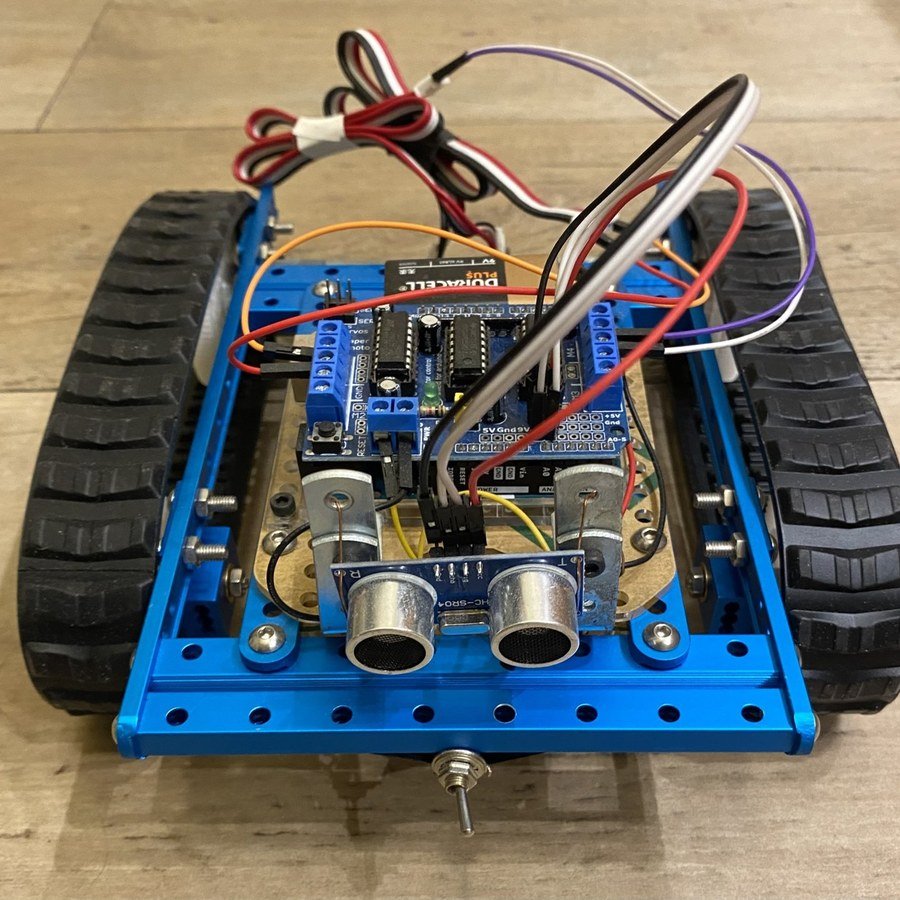
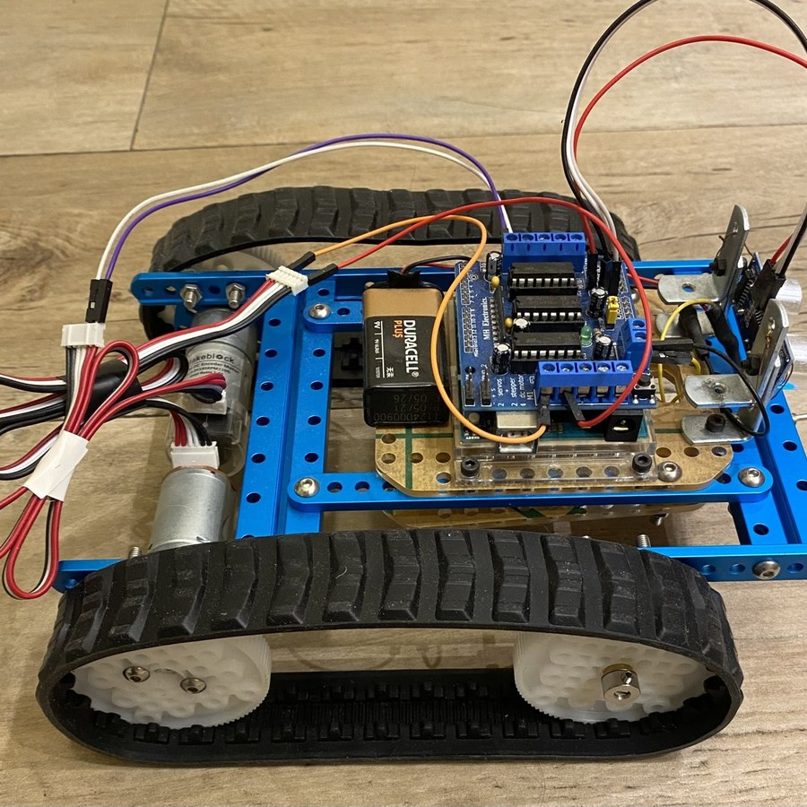
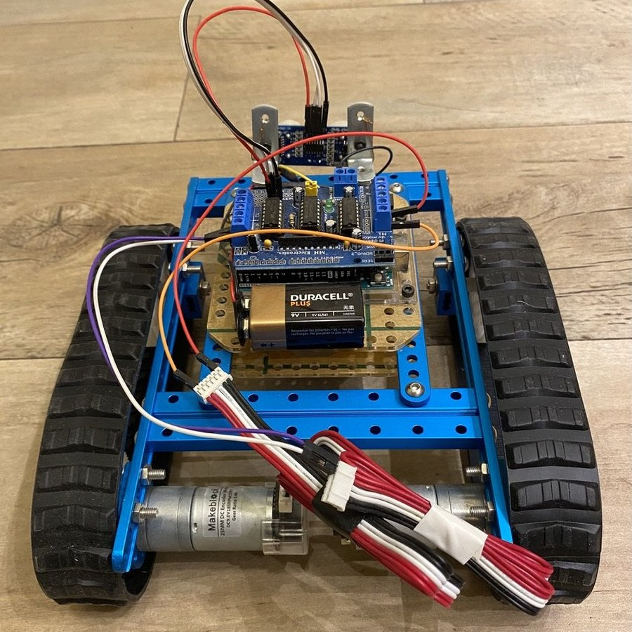

# Autonomous Obstacle-Avoidance Rover

**Obstacle Avoidance Algorithm for an Autonomous Mobile Robot (AMR)**

A tracked Arduino robot that senses obstacles via ultrasonic sonar and autonomously stops, backs off, and reroutes around them in real time.

<p align="center"></p>

## The problem

Starting from an existing tracked-robot kit, build a working obstacle-avoidance system: the rover has to drive on its own, detect obstacles in front of it with a low-cost sensor, and steer around them without overshooting into them. A MATLAB telemetry link shows what the motors are doing in real time.

## Approach

| | |
|---|---|
| **Platform** | Aluminum-alloy tracked chassis (refactored from an existing kit) with rubber tracks and plastic gearing |
| **Sensing** | HC-SR04 ultrasonic sonar (2-400 cm range, 1 cm resolution, 40 kHz, 30-degree beam); IR sensors evaluated but not used in the final design |
| **Actuation** | Two 9V DC encoder motors driven by an L293D H-bridge shield on an Arduino Uno |
| **Control** | Reactive loop in Arduino C++ with tuned stop/reverse/re-measure timing and soft speed ramps |
| **Telemetry** | MATLAB over serial: keyboard remote control and live motor-speed plots, with an obstacle alert |
| **Testing** | Sensor accuracy on iron, wood, plastic, glass and fabric; navigation on smooth flooring, carpet and concrete |

Avoidance logic, run every loop iteration:

```
drive forward  ->  obstacle <= 15 cm?  ->  stop  ->  reverse 300 ms  ->  stop
               ->  two fresh sonar readings  ->  pivot away  ->  re-check the path  ->  resume
```

The HC-SR04 is fixed and faces forward (no servo): instead of sweeping the sensor, the rover backs off, re-measures and pivots, and every loop iteration re-checks the path before driving on. This keeps the hardware minimal while still clearing the obstacle.

## Hardware

| Front | Side | Rear |
|:---:|:---:|:---:|
|  |  |  |
| HC-SR04 sonar, L293D shield on Arduino Uno, tracks | Aluminum tracked chassis, 25 mm DC encoder motors, 9V battery | Motors and wiring |

## Results

| Metric | Value |
|---|---|
| Obstacle distance that triggers the stop/avoid maneuver | 15 cm |
| Distance-reading error on metal obstacles (best case) | < 5 % |
| Distance-reading error on fabric obstacles (worst case) | 15-20 % |
| Turning-angle loss on carpet vs. smooth flooring | 20-30 % |

The tracks let the robot roll over small steps without falsely triggering the sensor, and the maneuver reliably sequences stop, reverse, re-measure and pivot before resuming. Live MATLAB telemetry confirmed that the motor response matched the commanded stop-reverse-turn sequence in real time.

## Repository layout

```
firmware/obstacle_avoidance/obstacle_avoidance.ino   Arduino sketch: sonar reading and avoidance loop
matlab/rover_remote_control.m                        arrow-key remote control + live motor plots
matlab/rover_obstacle_telemetry.m                    motor telemetry and obstacle alert during autonomous runs
media/                                               photos of the rover
```

## Running it

- **Firmware:** open `firmware/obstacle_avoidance/` in the Arduino IDE, install the `Adafruit Motor Shield library` (AFMotor, V1) and `NewPing` from the Library Manager, and upload to an Arduino Uno with the L293D shield. Wiring: HC-SR04 trigger on A0, echo on A1; motors on shield ports M1 and M4.
- **MATLAB:** both scripts use the built-in `serialport` interface at 9600 baud. Set `port` at the top of the script to your serial port, run it, and close the figure to stop. The remote-control script sends `F`/`B`/`L`/`R`/`S` and expects `motor1,motor2` lines back; the telemetry script expects `motor1,motor2,distance` lines.

## Context

Bachelor's thesis, Roma Tre University, 2024.

**Author:** Federico Falconi · [LinkedIn](https://www.linkedin.com/in/federico-falconi/)
